# CodeSource Correction Prosit — Architecture Web Distribuée

## Présentation du projet

Ce projet met en œuvre une architecture distribuée composée de plusieurs microservices développés avec différentes technologies. Les microservices sont enregistrés auprès d'un serveur **Eureka**, qui permet de consulter les instances disponibles.

Le projet couvre :
- la découverte des microservices avec Eureka ;
- l'exposition des informations de santé et d'information des services ;
- l'observabilité des services Spring Boot avec Spring Boot Actuator ;
- les endpoints de vérification des services Meeting et Notification.

## Architecture et ports

| Composant | Technologie | Port | Rôle |
|---|---|---:|---|
| Eureka Server | Java / Spring Boot | `8761` | Registre et découverte des microservices |
| Candidat | Java / Spring Boot | `8081` | Gestion des candidats |
| Job | Java / Spring Boot | `8082` | Gestion des offres d'emploi |
| Meeting | Node.js / Express | `8083` | Gestion des réunions |
| Notification | Python / FastAPI | `8084` | Gestion des notifications |
| Candidature | Java / Spring Boot | `8085` | Gestion des candidatures |

### Architecture logique

```text
                         Eureka Server
                         localhost:8761
                               |
          +--------------------+--------------------+
          |          |         |         |           |
       Candidat     Job     Meeting  Notification  Candidature
        :8081      :8082     :8083      :8084        :8085
       Spring      Spring    Express   FastAPI      Spring
        Boot        Boot      Node.js   Python       Boot
```

## Technologies utilisées

- Java et Spring Boot
- Spring Cloud Netflix Eureka Client / Server
- Spring Boot Actuator
- Node.js et Express
- Python et FastAPI
- Uvicorn
- `py-eureka-client`
- Swagger / OpenAPI
- Maven

## Prérequis

Installer et configurer les outils nécessaires :
- JDK compatible avec les projets Spring Boot ;
- Maven ;
- Node.js et npm ;
- Python ;
- un navigateur web.

## Démarrage du projet

Démarrer les services dans des terminaux séparés. Il est recommandé de lancer **Eureka en premier**, puis les microservices.

### 1. Démarrer Eureka

Ouvrir le dossier du serveur Eureka dans IntelliJ et lancer la classe principale Spring Boot.

Tableau de bord : http://localhost:8761

### 2. Démarrer Candidat

Depuis le dossier du microservice Candidat, dans PowerShell :

```powershell
mvn "-Dmaven.test.skip=true" spring-boot:run
```

Port : `8081`.

### 3. Démarrer Job

Depuis le dossier du microservice Job, dans PowerShell :

```powershell
mvn "-Dmaven.test.skip=true" spring-boot:run
```

Port : `8082`.

### 4. Démarrer Meeting

Depuis `backend/microservices/meeting`, dans PowerShell :

```powershell
npm start
```

Port : `8083`.

Endpoints :
- http://localhost:8083/health
- http://localhost:8083/info
- http://localhost:8083/swagger-ui

### 5. Démarrer Notification

Depuis `backend/microservices/notification`, dans PowerShell :

```powershell
python -m uvicorn app.main:app --reload --port 8084
```

Endpoints :
- http://localhost:8084/health
- http://localhost:8084/info
- http://localhost:8084/swagger-ui
- http://localhost:8084/v3/api-docs
- http://localhost:8084/redoc

### 6. Démarrer Candidature

Depuis le dossier du microservice Candidature (`canditature`) :

```powershell
mvn "-Dmaven.test.skip=true" spring-boot:run
```

Port : `8085`.

> Si la commande `mvn` n'est pas reconnue sous Windows, utiliser le chemin Maven configuré sur la machine ou lancer le projet depuis IntelliJ IDEA.

### Installation des dépendances (première exécution)

- **Meeting** : exécuter `npm install` une première fois dans `backend/microservices/meeting`.
- **Notification** : créer/activer l'environnement virtuel puis installer les dépendances avec `python -m pip install -r requirements.txt` dans `backend/microservices/notification`.

## Observabilité — Atelier 2

### Spring Boot Actuator

Pour les microservices Spring Boot concernés, Actuator expose des endpoints de supervision. La configuration utilisée dans les fichiers `application.properties` peut inclure :

```properties
management.endpoints.web.exposure.include=health,info,metrics
management.endpoint.health.show-details=always
management.info.env.enabled=true
eureka.client.healthcheck.enabled=true
```

Exemples d'endpoints :
- `/actuator/health` : état de santé ;
- `/actuator/info` : informations du service ;
- `/actuator/metrics` : liste des métriques ;
- `/actuator/metrics/jvm.memory.used` : utilisation mémoire JVM ;
- `/actuator/metrics/http.server.requests` : statistiques des requêtes HTTP.

Les URLs exactes dépendent du port du microservice.

### Meeting — Express

Meeting expose :
- `GET /health` : retourne l'état `UP` ;
- `GET /info` : retourne le nom et la version lus depuis `package.json`.

### Notification — FastAPI

Notification expose :
- `GET /health` : retourne `{"status": "UP"}` ;
- `GET /info` : retourne le nom `notification` et la version `1.0.0`.

Le client `py-eureka-client` est démarré avec le cycle de vie FastAPI. Sa configuration publie le service `NOTIFICATION` et les URL de santé et d'information.

## Vérification dans Eureka

Ouvrir le tableau de bord :

http://localhost:8761

Les instances des microservices démarrés doivent apparaître dans le registre.

Pour consulter les informations enregistrées pour Notification :

```powershell
Invoke-RestMethod `
  -Uri "http://localhost:8761/eureka/apps/NOTIFICATION" `
  -Headers @{"Accept"="application/json"}
```

## Tests

### Notification

```powershell
python -m pip install -r requirements-dev.txt
pytest
```

### Tests manuels

Ouvrir les endpoints `/health` et `/info` de Meeting et Notification dans un navigateur, puis vérifier l'enregistrement des services dans Eureka.

Pour les services Spring Boot, vérifier `/actuator/health`, `/actuator/info` et `/actuator/metrics` lorsque Actuator est configuré et démarré.

## Captures d'écran

Les captures sont **intégrées ci-dessous**. Pour qu'elles s'affichent aussi sur GitHub, gardez le dossier `screenshots/` à côté de ce fichier `README.md` et ajoutez les deux au dépôt Git.

### Tableau de bord Eureka


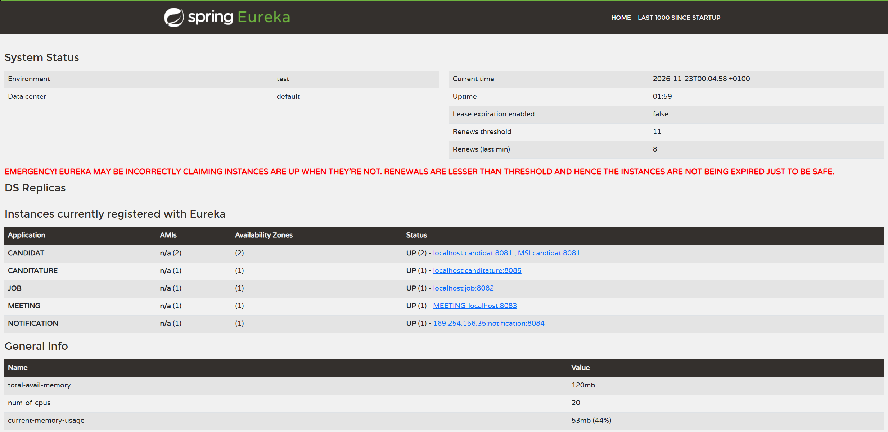

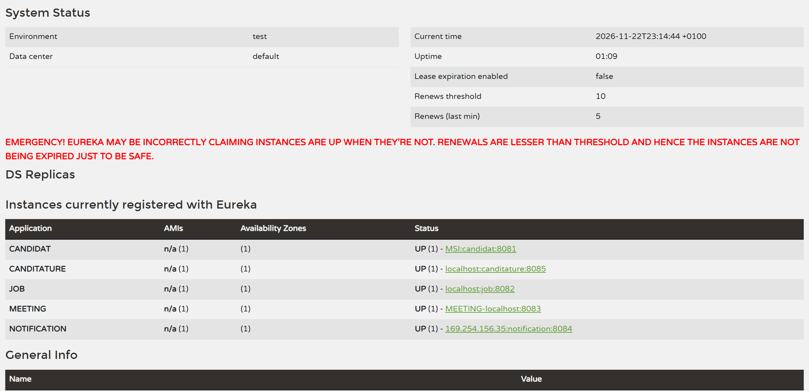


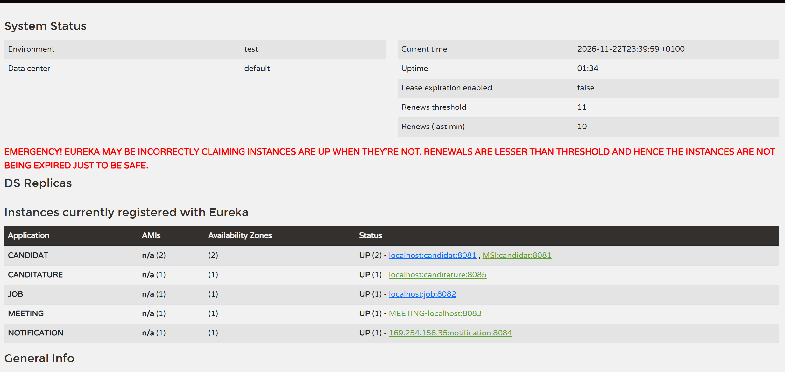

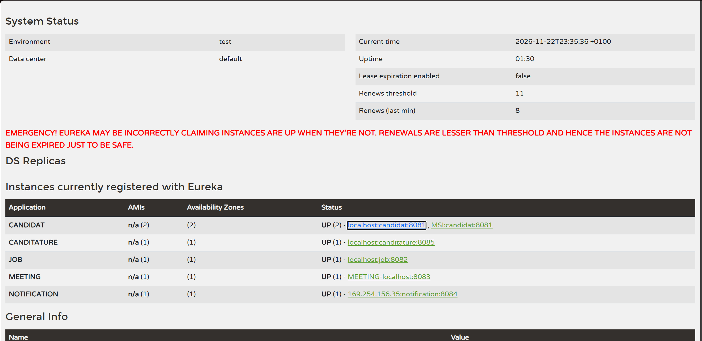

### Notification

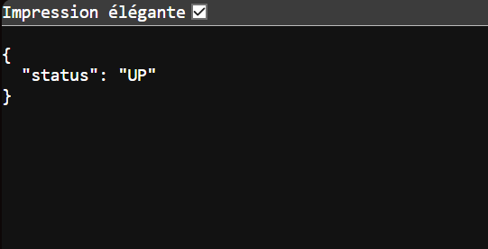

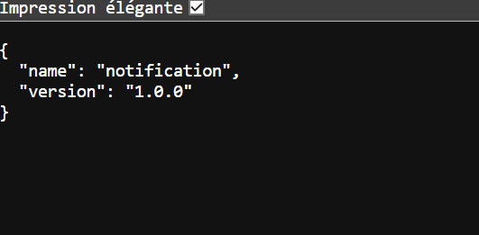

### Meeting

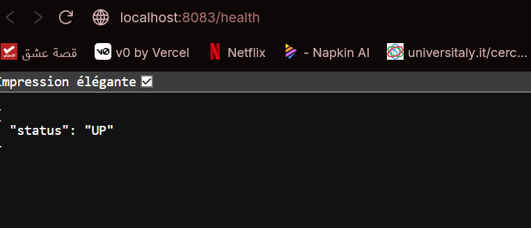


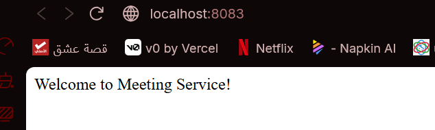

### Services Spring Boot

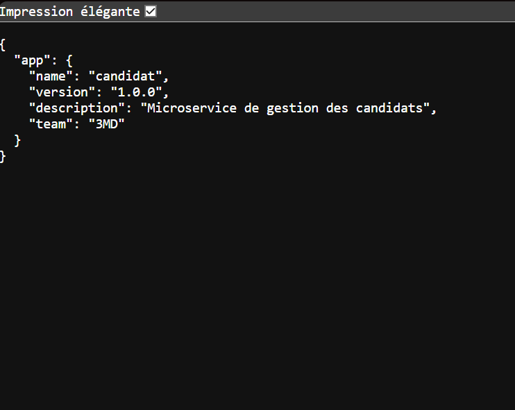

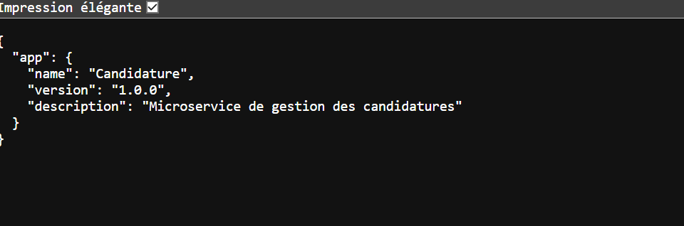

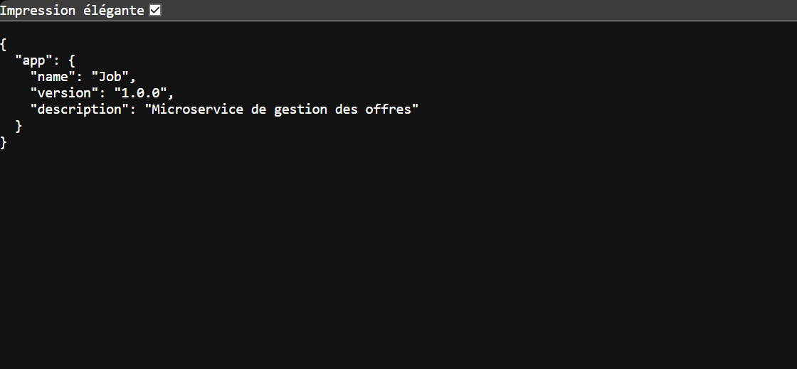

## Structure générale

```text
codeSource_correctionProsit/
├── README.md
├── screenshots/
└── backend/
    └── microservices/
        ├── eureka/
        ├── candidat/
        ├── job/
        ├── meeting/
        ├── notification/
        └── canditature/
```

## Membres de l'équipe

- Douaa Ben Rejab
- Manel Hosni
- Maryem Bdira Filali
- Mahdi Ben Fattoum

## Remarques

- Démarrer Eureka avant les clients Eureka.
- Vérifier que chaque microservice est bien démarré avant de contrôler son état dans le tableau de bord Eureka.
- Les résultats présentés dans les captures correspondent aux tests réalisés sur les endpoints du projet.
