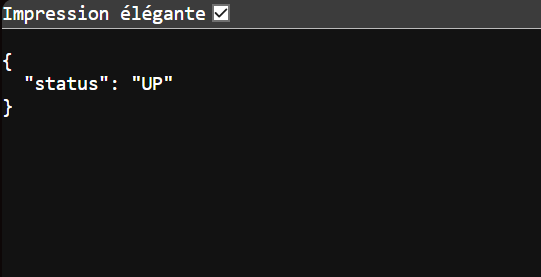
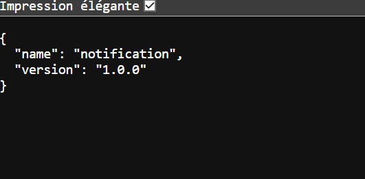
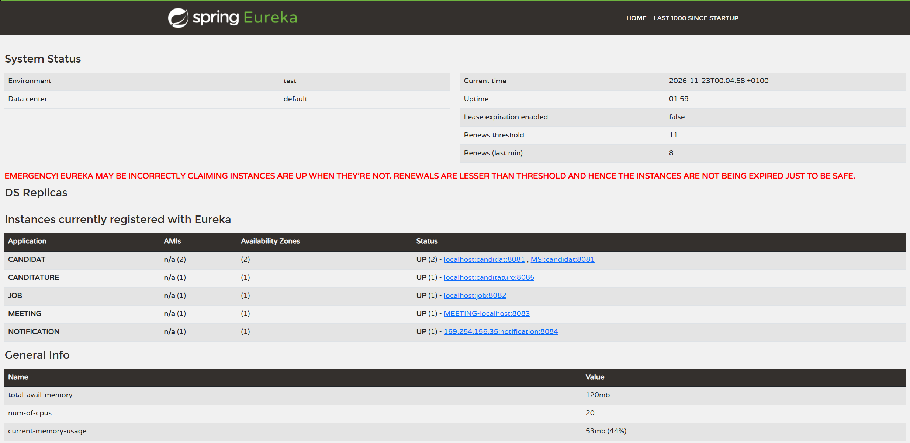
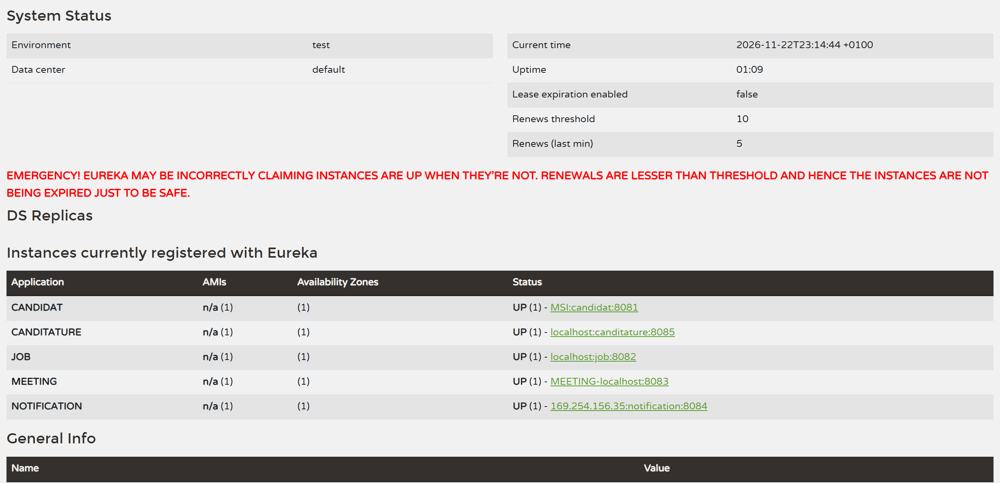
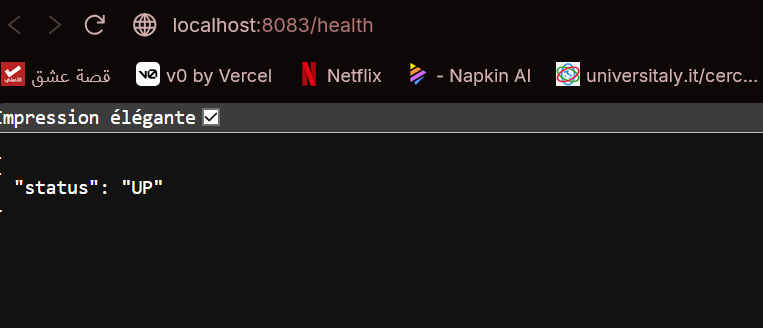
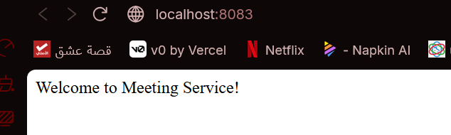
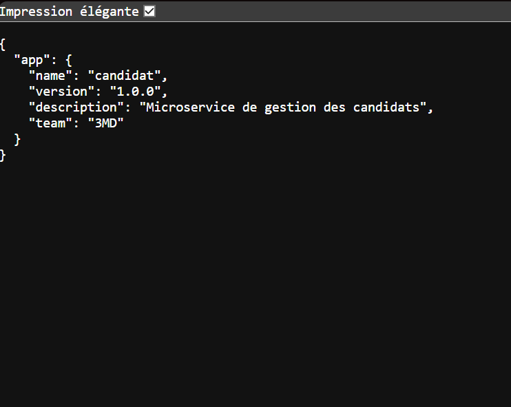
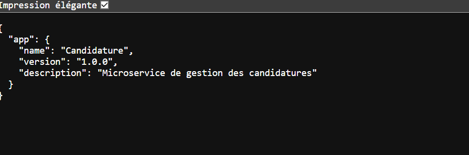
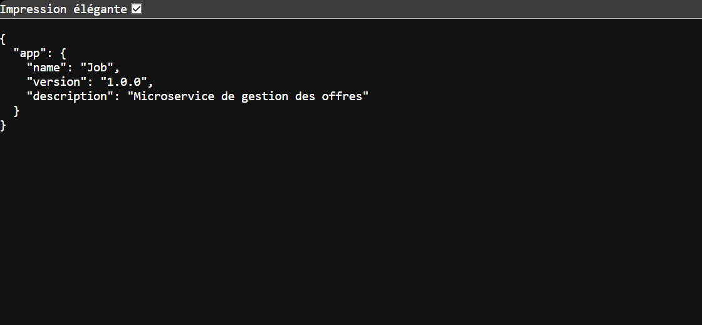

# Notification Microservice

Microservice de gestion des notifications développé avec **Python** et **FastAPI**, sans base de données. La documentation API est générée automatiquement avec OpenAPI.

Le service expose :
- `GET /api/notifications/hello` : endpoint de démonstration existant.
- `GET /health` : vérification de l'état du microservice.
- `GET /info` : informations sur le microservice.

Le microservice est également configuré pour s'enregistrer auprès du serveur **Eureka**.

## Technologies utilisées

- Python
- FastAPI
- Uvicorn
- py-eureka-client
- Spring Cloud Netflix Eureka

## Configuration

| Élément | Valeur |
|---|---|
| Nom Eureka | `NOTIFICATION` |
| Port | `8084` |
| Serveur Eureka | `http://localhost:8761/eureka` |
| Base de données | Aucune |

## Installation et lancement

Depuis le dossier `notification` :

```powershell
# 1. Créer l'environnement virtuel (une seule fois)
python -m venv venv

# 2. Activer l'environnement virtuel sous Windows PowerShell
.\venv\Scripts\Activate.ps1

# 3. Installer les dépendances
python -m pip install -r requirements.txt

# 4. Lancer le microservice
python -m uvicorn app.main:app --reload --port 8084
```

Pour exécuter les tests :

```powershell
python -m pip install -r requirements-dev.txt
pytest
```

## Endpoints

| Méthode | URL | Description |
|---|---|---|
| GET | `http://localhost:8084/api/notifications/hello` | Endpoint de démonstration |
| GET | `http://localhost:8084/health` | État du service |
| GET | `http://localhost:8084/info` | Nom et version du service |
| GET | `http://localhost:8084/swagger-ui` | Interface Swagger |
| GET | `http://localhost:8084/v3/api-docs` | Spécification OpenAPI JSON |
| GET | `http://localhost:8084/redoc` | Documentation ReDoc |

### Résultats attendus

**`GET /health`**

```json
{
  "status": "UP"
}
```

**`GET /info`**

```json
{
  "name": "notification",
  "version": "1.0.0"
}
```

## Enregistrement dans Eureka

Le client Eureka est démarré avec le cycle de vie de l'application FastAPI. Il doit publier le service sous le nom `NOTIFICATION`, avec les URL de santé et d'information :

- Health check : `http://localhost:8084/health`
- Status page : `http://localhost:8084/info`

Pour vérifier l'enregistrement, lancer Eureka puis ouvrir :

`http://localhost:8761/eureka/apps/NOTIFICATION`

L'interface Eureka est disponible à :

`http://localhost:8761`

## Captures d'écran

### Réponse de l'endpoint `/health`



### Réponse de l'endpoint `/info`



### Enregistrement des microservices dans Eureka





### Autres captures du projet

**Meeting — endpoint health**



**Meeting — endpoint info**


**Meeting — page d'accueil**



**Candidat — endpoint info**



**Candidature — endpoint info**



**Job — endpoint info**



## Structure du projet

```text
notification/
├── app/
│   ├── main.py
│   ├── schemas.py
│   └── routers/
│       └── notification.py
├── tests/
│   └── test_hello.py
├── TODO.md
├── requirements.txt
├── requirements-dev.txt
├── pytest.ini
└── README.md
```

## Remarque

La logique métier complète des notifications reste à développer selon les consignes du projet (voir `TODO.md`).
